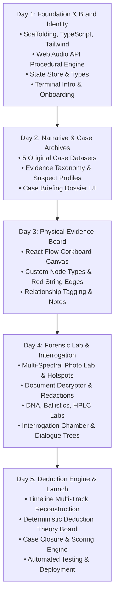

# CASEFILE 09 // 5-DAY PROJECT IMPLEMENTATION ROADMAP
> **Federal Criminal Investigation Simulator**
> *Every clue tells a story. Not every story tells the truth.*

---

## Executive Overview
This document breaks down the end-to-end development of **CASEFILE 09** into a structured, modular 5-day engineering roadmap. Each day delivers a standalone, fully verified subsystem building toward the complete detective investigation simulator.

---

## 📅 Roadmap Summary

---

## 📌 Day-by-Day Breakdown

### 🔹 DAY 1: Foundation, Brand Identity, Core Engines & Setup
- **Objective**: Establish the core project architecture, classified neo-noir design system, persistent state store, procedural audio engine, and opening user experience.
- **Key Deliverables**:
  1. Vite 6 + React 19 + TypeScript 5.7 project scaffolding.
  2. Tailwind CSS configuration with customized neo-noir palette (`charcoal-950`, `evidence-red`, `military-olive`, `dossier-paper`).
  3. Typography hierarchy using Google Fonts (`Oswald`, `IBM Plex Mono`, `DM Sans`, `Courier Prime`).
  4. Strongly typed TypeScript models (`case.ts`, `investigator.ts`).
  5. Web Audio API procedural sound engine (`audioEngine.ts`) with zero external MP3 dependencies (typewriter clacks, rubber stamps, camera clicks, cassette hum, and sub-bass binaural drone).
  6. Persistent game store with Zustand (`useGameStore.ts`) syncing to `localStorage`.
  7. Analog terminal boot intro (`IntroPage.tsx`) with classified clearance authentication.
  8. Investigator accreditation dossier (`OnboardingPage.tsx`) with callsign and difficulty clearance.
  9. Command Headquarters hub (`HeadquartersPage.tsx`).
- **Verification**: Zero TypeScript build errors, terminal typing sequence functional, audio triggers operational, onboarding data persisted.

---

### 🔹 DAY 2: Case Architecture, Narrative Dossiers & Archives
- **Objective**: Author original fictional criminal investigations with authentic narrative depth, evidence taxonomy, and suspect alibis.
- **Key Deliverables**:
  1. Case repository data structure (`src/data/cases/`).
  2. Authoring 5 complete criminal cases:
     - **CASE 001: The Silent Witness** (Elena Vance homicide in locked apartment; Marcus Sterling kickback conspiracy).
     - **CASE 002: Midnight at Blackwood** (Lord Alistair disappearance during nor'easter; Julian Blackwood disinheritance).
     - **CASE 003: The Last Transmission** (Jonas Miller signal tower vanishing; Officer Frank Navarro naval salvage coverup).
     - **CASE 004: Ashes of Yesterday** (Samuel Vance 1988 cold case elevator vault entombment; Raymond Cross land fraud).
     - **CASE 009: The Ninth File** (**Master Conspiracy Case**; *Project Chimera* linking all cases to Executive Director Vance Sterling).
  3. Searchable and filterable case archive (`ArchivePage.tsx`).
  4. Classified case briefing dossier screen (`CaseBriefingPage.tsx`).
- **Verification**: All 5 cases fully searchable, filterable by status/difficulty, Case 009 locked until clearance prerequisites met.

---

### 🔹 DAY 3: Main Investigation Workspace & Physical Evidence Board
- **Objective**: Build an interactive, tactile detective evidence board on an infinite hardware-accelerated canvas.
- **Key Deliverables**:
  1. `@xyflow/react` canvas implementation (`BoardCanvas.tsx`).
  2. Custom specialized node components:
     - `PhotoNode.tsx` (Polaroid styling with exhibit stamps).
     - `DocumentNode.tsx` (Classified memos with typewriter text).
     - `ForensicNode.tsx` (Lab slides with certified badges).
     - `NoteNode.tsx` (Editable sticky notes with red pushpin graphics).
     - `VictimNode.tsx` (Incident epicenter card).
  3. Custom red string yarn edges (`InvestigationEdge.tsx`) with semantic relationship badges:
     - `Supports`, `Contradicts`, `Establishes Timeline`, `Possible Motive`, `Related To`.
  4. Real-time pin-to-board capability from the evidence drawer.
- **Verification**: Smooth node dragging, zoom/pan navigation, string connection modal, note editing, and auto-layout.

---

### 🔹 DAY 4: Criminalistics Forensic Laboratory & Interrogation Chamber
- **Objective**: Develop deep-dive forensic analysis tools and a cinematic branching interrogation chamber.
- **Key Deliverables**:
  1. Multi-Spectral Photographic Examination Lab (`PhotoLab.tsx`):
     - Optical Zoom (70%–250%) and 90° rotation.
     - Spectral light filters: Standard, UV Fluorescence, Infrared, and Optical Magnifier.
     - Clickable interactive hotspots revealing concealed physical clues.
  2. Optical Document Decryptor (`DocumentLab.tsx`):
     - Scanned parchment typography with typewriter font.
     - Click-to-decrypt blacked-out classified redactions.
     - SHA-256 integrity audit and metadata inspector.
  3. Forensic Laboratory Workstation (`ForensicReportsLab.tsx`):
     - DNA Agarose Gel Electrophoresis with animated band migration.
     - Ballistics Split-Screen Comparator with movable barrel striation slider.
     - Toxicology HPLC Chromatogram with retention time peaks.
  4. Suspect Interrogation Chamber (`InterrogationRoom.tsx`):
     - Tape recorder reel animation and audio feedback.
     - Dynamic 0%–100% psychological composure/stress meter.
     - Deterministic branching dialogue trees.
     - "Present Discovered Clue" drawer to confront suspects.
     - Contradiction exposure mechanic triggering confessions.
- **Verification**: Hotspot discovery triggers, document redactions decrypt, forensic instruments render accurately, suspect stress reacts dynamically.

---

### 🔹 DAY 5: Chronological Timeline, Deduction Engine & Launch
- **Objective**: Implement chronological timeline reconstruction, deterministic deduction engine, formal case closure, scoring, and production deployment.
- **Key Deliverables**:
  1. Chronological Timeline Reconstruction (`TimelineBoard.tsx`):
     - Multi-track timeline (Victim, Suspects, Forensic, Police).
     - Slot placement controls (Move Up / Down) with live validation.
     - Automatic contradiction alerts for alibi clashes.
  2. Deduction Engine & Theory Board (`TheoryBoard.tsx`):
     - Proposed Culprit selection.
     - Motive articulation and Method reconstruction.
     - Supporting evidence and refuted contradiction linkage.
     - Live theory strength calculation.
  3. Formal Indictment Submission modal (`CaseClosureModal.tsx`).
  4. After-Action Report (AAR) & Results (`ResultsPage.tsx`):
     - Deterministic scoring algorithm out of 1000 points.
     - 6 investigator ranks (Trainee to Elite Investigator).
     - 8 unlockable commendation medals with celebratory confetti.
  5. Automated Verification Test Suite (`test-investigation-suite.ts`):
     - 50/50 automated test assertions passed.
  6. Production deployment and Git version control.
- **Verification**: Complete playable walkthrough from onboarding through case closure with verified scoring.
