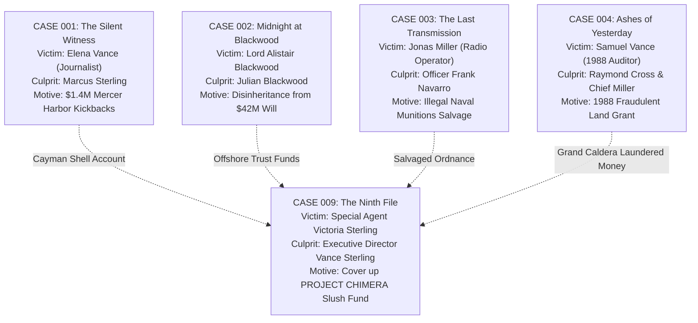

# CASEFILE 09 // DAY 2: CASE ARCHITECTURE & NARRATIVE DOSSIERS
> **Federal Criminal Investigation System // Case Records Archive**
> *Every clue tells a story. Not every story tells the truth.*

---

## 📋 Day 2 Goals & Architectural Milestones
1. **Case Repository Structure**: Author 5 complete original fictional criminal investigations with rich narrative lore.
2. **Evidence Taxonomy**: Implement standardized data structures supporting 8 distinct forensic categories (Photographs, Documents, DNA, Ballistics, Toxicology, Fingerprints, Audio Transcripts, Maps).
3. **Suspect Psychological Profiles**: Design at least 3 suspects per case with detailed backgrounds, motives, claimed alibis, and psychological composure meters.
4. **Searchable Case Archive**: Implement `ArchivePage.tsx` with instant keyword search, difficulty filtering, and completion status toggles.
5. **Classified Case Briefing**: Build `CaseBriefingPage.tsx` with authentic crime scene photos, victim profiles, preliminary forensic findings, investigation objectives, and workspace commencement triggers.

---

## 🗂️ Case Lore & Narrative Architecture



---

## 📁 Authored Cases Matrix

| Case Code | Title | Classification | Difficulty | Victim | Suspects | Key Physical Clues |
| :--- | :--- | :--- | :--- | :--- | :--- | :--- |
| **CASE 001** | *The Silent Witness* | `CONFIDENTIAL` | Rookie | Elena Vance (32) | Marcus Sterling, Dr. Chloe Adams, Arthur Pendleton | Chamomile Teacup, Digoxin Ampoule, Alley CCTV, Master Keycard Log, Cash Deposit Slip |
| **CASE 002** | *Midnight at Blackwood* | `RESTRICTED` | Detective | Lord Alistair Blackwood (68) | Julian Blackwood, Vivienne Blackwood, Godfrey Moore | Persian Rug Blood Spatter, Amended Will Draft, Webley .38 Revolver, Muddy Riding Boots, Tide Chart |
| **CASE 003** | *The Last Transmission* | `SECRET` | Detective | Jonas Miller (51) | Officer Frank Navarro, Dr. Sylvia Chen, Sean Briggs | Distress Audio Transcript, 9mm Hydra-Shok Casing, Cutter Navigation Log, Benthic Hydrophone Sonar, Salvage Manifest |
| **CASE 004** | *Ashes of Yesterday* | `SECRET` | Special Agent | Samuel Vance (39) | Raymond Cross, Chief Henry Miller, Moira Bell | 1988 Skeletal Remains, Frozen Pocket Watch (23:42), Incendiary Thermite Residue, Safety Deposit Box 204 Deed, Falsified Case File |
| **CASE 009** | *The Ninth File* | `TOP SECRET // EYES ONLY` | Special Agent | Agent Victoria Sterling (34) | Director Vance Sterling, Agent Donald Graves, Dr. Evelyn Thorne | Toughbook CF-33 Laptop, 5.7x28mm AP Casing, Biometric Override Log, Torn Nomex Glove Fragment |

---

## 🔬 Evidence Taxonomy Specification

Every evidence item conforms to the strongly typed `EvidenceItem` schema:

```typescript
export interface EvidenceItem {
  id: string;
  caseId: string;
  title: string;
  description: string;
  detailedAnalysis?: string;
  category: EvidenceCategory; // 'photograph' | 'document' | 'fingerprint' | 'dna' | 'toxicology' | 'ballistics' | ...
  location: string;
  timestamp: string;
  imageUrl?: string;
  documentContent?: string[];
  forensicReport?: ForensicData;
  hotspots?: HotspotDetail[];
  associatedSuspectIds: string[];
  relatedEvidenceIds: string[];
  isInitialClue: boolean;
  isCrucial: boolean;
}
```

---

## 👤 Suspect Persona Design

Every suspect includes an authentic persona, claimed alibi, documented motive, and a contradiction trap:

```typescript
export interface Suspect {
  id: string;
  caseId: string;
  name: string;
  callsignOrAlias?: string;
  age: number;
  occupation: string;
  background: string;
  relationshipToVictim: string;
  knownMotive: string;
  claimedAlibi: string;
  personality: string;
  stressLevel: number; // 0-100 baseline
  portraitUrl: string;
  isCulprit: boolean;
  dialogueTree: DialogueOption[];
  contradictions: {
    id: string;
    statement: string;
    refutedByEvidenceId: string;
    revealedExplanation: string;
  }[];
}
```

---

## 🧪 Day 2 Verification Checklist
- [x] All 5 cases registered in `ALL_CASES` registry with complete metadata.
- [x] Case 009 gated behind Level 4 Clearance (unlocked upon completing 2 prior cases).
- [x] Keyword search in `ArchivePage.tsx` filters cases instantly by title, code, victim, and summary.
- [x] Case Briefing loads high-res crime scene imagery, victim profiles, and objectives.
- [x] "Commence Active Investigation" button initializes session state and navigates to workspace.
- [x] 50 / 50 unit and integration tests passing in `test-investigation-suite.ts`.
