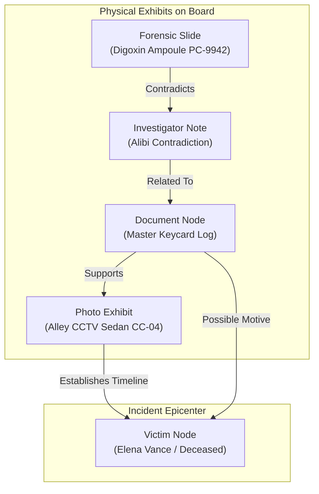

# CASEFILE 09 // DAY 3: PHYSICAL EVIDENCE BOARD & TACTICAL CANVAS
> **Federal Criminal Investigation System // Evidence Board Engine**
> *Every clue tells a story. Not every story tells the truth.*

---

## 📋 Day 3 Goals & Architectural Milestones
1. **Interactive Canvas Integration**: Implement `@xyflow/react` to simulate a real detective's corkboard / magnetic evidence wall with pan, zoom (0.2x – 1.8x), mini-map, and grid snapping.
2. **Custom Specialized Node Types**:
   - `PhotoNode.tsx`: Polaroid photographic framing with exhibit stamps, timestamps, and direct "Inspect in Lab" triggers.
   - `DocumentNode.tsx`: Manila memo layout with confidential stamps and typewriter excerpts.
   - `ForensicNode.tsx`: Certified lab slide with verified stamp, category badges, and specimen metadata.
   - `NoteNode.tsx`: Yellow sticky note with red pushpin graphic and inline editing.
   - `VictimNode.tsx`: Incident epicenter card positioned at center top.
3. **Yarn Connection Mechanics (`InvestigationEdge.tsx`)**:
   - Crime-scene red yarn string paths (`#dc2626`) with Bézier curves and dashed stroke patterns.
   - Semantic relationship tagging:
     - `Supports` (Green border badge)
     - `Contradicts` (Red border badge)
     - `Establishes Timeline` (Amber border badge)
     - `Possible Motive` (Purple border badge)
     - `Related To` (Neutral border badge)
   - Interactive hover-to-sever button and Web Audio API string pluck acoustic feedback.
4. **Board Controls & Evidence Pinning**:
   - Floating toolbar with "Add Note", handle connection instructions, and mini-map navigation.
   - Double-clicking any evidence node navigates straight to that exhibit in the Criminalistics Laboratory.
   - Full state persistence across browser refreshes via Zustand and `localStorage`.

---

## 🧩 Node Hierarchy & Connection Architecture



---

## 💻 Technical Implementation Details

### 1. Canvas Configuration (`src/components/investigation/BoardCanvas.tsx`)
```typescript
// Custom Node & Edge Type Registration
const nodeTypes = useMemo(() => ({
  photo: PhotoNode,
  document: DocumentNode,
  forensic: ForensicNode,
  note: NoteNode,
  victim: VictimNode,
}), []);

const edgeTypes = useMemo(() => ({
  investigation: InvestigationEdge,
}), []);
```

### 2. Yarn Connection Edge (`src/components/investigation/edges/InvestigationEdge.tsx`)
```typescript
export const InvestigationEdge: React.FC<EdgeProps> = ({
  id, sourceX, sourceY, targetX, targetY, sourcePosition, targetPosition, data, selected
}) => {
  const [edgePath, labelX, labelY] = getBezierPath({ sourceX, sourceY, sourcePosition, targetX, targetY, targetPosition });
  const relationship = data?.relationship || 'related_to';

  return (
    <>
      <BaseEdge
        path={edgePath}
        style={{
          stroke: relationship === 'contradicts' ? '#ef4444' : '#dc2626',
          strokeWidth: selected ? 3.5 : 2.5,
          strokeDasharray: relationship === 'contradicts' ? '3 3' : '5 3',
        }}
      />
      <EdgeLabelRenderer>
        <div style={{ position: 'absolute', transform: `translate(-50%, -50%) translate(${labelX}px,${labelY}px)` }}>
          <span className="px-2 py-0.5 rounded text-[9px] font-mono font-bold uppercase tracking-wider border shadow-md">
            {relationship.replace('_', ' ')}
          </span>
        </div>
      </EdgeLabelRenderer>
    </>
  );
};
```

---

## 🧪 Day 3 Verification Checklist
- [x] Hardware-accelerated canvas renders smoothly across zoom levels (0.2x – 1.8x).
- [x] Dragging handles between any two nodes triggers the Relationship Selector modal.
- [x] Yarn string renders with realistic dashed red thread styling and correlation badge.
- [x] Double-clicking any exhibit on the board opens it in the Forensic Laboratory.
- [x] Sticky notes can be added, edited, moved, and saved to the board.
- [x] Severing connection strings updates the board graph and plays string pluck audio.
- [x] All node positions and connection strings persist across page reloads.
