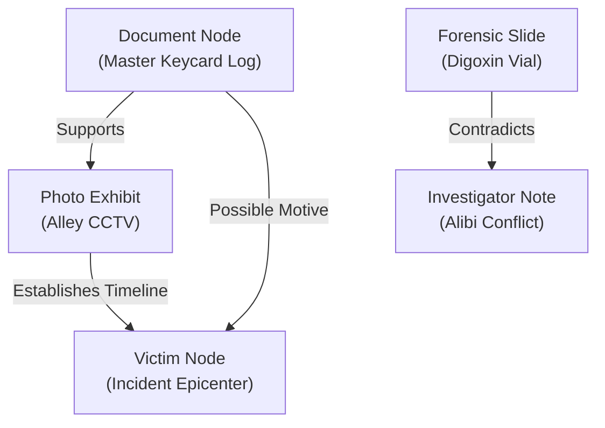

# CASEFILE 09 // DAY 3: PHYSICAL EVIDENCE BOARD & TACTICAL CANVAS

---

## 📋 Day 3 Goals & Deliverables
1. **Interactive Canvas**: Integrate `@xyflow/react` to simulate a real detective's corkboard / magnetic evidence wall.
2. **Custom Specialized Nodes**:
   - `PhotoNode.tsx`: Polaroid photographic styling with exhibit stamps, timestamps, and lab inspection triggers.
   - `DocumentNode.tsx`: Manila parchment with typewriter text, confidential stamps, and excerpt quotes.
   - `ForensicNode.tsx`: Certified lab slide with verified stamp and specimen metadata.
   - `NoteNode.tsx`: Yellow sticky note with red pushpin graphic and inline editing.
   - `VictimNode.tsx`: Incident epicenter card positioned at center top.
3. **Yarn Connection Mechanics (`InvestigationEdge.tsx`)**:
   - Red string yarn paths with customizable relationship labels:
     - `Supports` (Green border badge)
     - `Contradicts` (Red border badge)
     - `Establishes Timeline` (Amber border badge)
     - `Possible Motive` (Purple border badge)
     - `Related To` (Neutral border badge)
   - Hover-to-sever button and audio string pluck feedback.
4. **Board Controls**: Floating toolbar with Add Note, Drag Handle instructions, and MiniMap navigation.

---

## 🧩 Node Hierarchy & Connection Flow

---

## 🧪 Day 3 Verification Checklist
- [x] Smooth pan, zoom (0.2x – 1.8x), and drag interactions across desktop and touchscreens.
- [x] Connecting two nodes displays the relationship selector modal.
- [x] Double-clicking an evidence node directly opens it in the Forensic Laboratory.
- [x] Custom notes can be added, edited, and moved on the board.
- [x] Board positions and connection strings persist across sessions.
