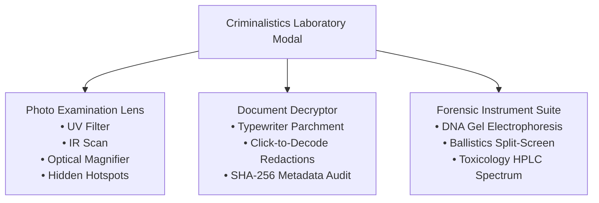

# CASEFILE 09 // DAY 4: CRIMINALISTICS LABORATORY & INTERROGATION CHAMBER

---

## 📋 Day 4 Goals & Deliverables
1. **Multi-Spectral Photo Lab (`PhotoLab.tsx`)**:
   - Optical zoom slider (70% to 250%) and 90° rotation controls.
   - Spectral lighting filters:
     - ⚡ **UV Fluorescence**: Highlights synthetic binder starches and invisible drug powder residue.
     - 🔥 **Infrared Scan**: Uncovers heat and burn residue.
     - 🔍 **Optical Magnifier**: Enhances micro-scratches, signet ring impressions, and serial numbers.
   - Clickable interactive hotspots revealing concealed physical clues.
2. **Optical Document Decryptor (`DocumentLab.tsx`)**:
   - Realistic parchment paper layout with typewriter typography.
   - Interactive click-to-decode on blacked-out classified redactions.
   - SHA-256 integrity hash verification and custody metadata panel.
3. **Forensic Instrument Suite (`ForensicReportsLab.tsx`)**:
   - **DNA Agarose Gel Electrophoresis**: Animated migration lanes comparing Ladder, Victim, Specimen, and Suspect bands.
   - **Ballistics Split-Screen Comparator**: Movable slider comparing microscopic rifling striations between crime scene projectiles and seized firearms.
   - **Toxicology HPLC Chromatogram**: Spectral peak analyzer showing retention times and lethal dose thresholds.
4. **Suspect Interrogation Chamber (`InterrogationRoom.tsx`)**:
   - Noir atmosphere with animated tape recorder reels.
   - Dynamic 0%–100% psychological composure/stress meter.
   - Branching dialogue trees with deterministic responses.
   - "Present Discovered Clue" drawer to confront suspects with physical evidence.
   - Contradiction exposure mechanic triggering confessions and alibi collapses.

---

## 🔬 Forensic Lab Architecture

---

## 🧪 Day 4 Verification Checklist
- [x] Photo lab filters alter image rendering in real time.
- [x] Clickable hotspots unlock concealed evidence items and trigger tension audio.
- [x] Blacked-out redactions decrypt on user click.
- [x] Forensic instruments render animated DNA gel bands, ballistics slider, and HPLC curves.
- [x] Suspect interrogation tracks inquiry history and spikes stress upon confronting with physical evidence.
