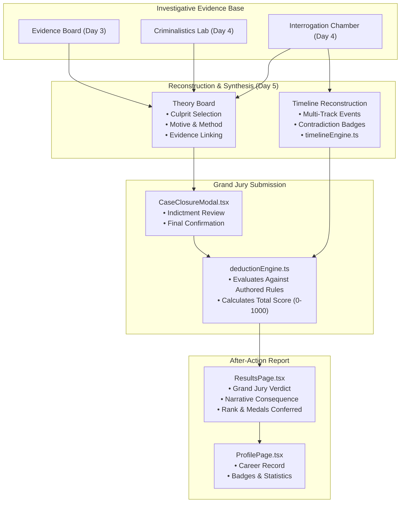

# CASEFILE 09 // DAY 5: CHRONOLOGICAL TIMELINE, DEDUCTION ENGINE & FINAL SUBMISSION
> **Federal Criminal Investigation Simulator**
> *Every clue tells a story. Not every story tells the truth.*

---

## 📋 Day 5 Executive Summary & Deliverables

Day 5 represents the culmination and analytical climax of **CASEFILE 09**:
1. **Chronological Timeline Reconstruction (`TimelineBoard.tsx`)**:
   - Multi-category timeline visualization: `Victim`, `Suspect`, `Forensic`, `Police`.
   - Tactile slot placement controls (`Move Up` / `Move Down`) with live chronological validation.
   - Contradiction warnings highlighting conflicts between suspect testimonies and forensic timestamps.
   - Real-time Chronological Integrity Score ($0\%\text{--}100\%$) powered by `timelineEngine.ts`.
   - One-click auto-align capability resetting events to verified timestamps.

2. **Deduction Engine & Theory Board (`TheoryBoard.tsx`)**:
   - Structured legal indictment builder:
     1. **Primary Perpetrator selection**: Choose from verified case suspects.
     2. **Motive articulation**: Formulate documented financial, personal, or conspiracy motives.
     3. **Execution Method & Opportunity**: Detail physical entry, murder weapon, and timing.
     4. **Crucial Supporting Evidence linkage**: Tag tangible exhibits proving guilt.
     5. **Refuted Alibi & Contradiction linkage**: Expose fabricated testimonies.
   - Real-time Theory Strength Meter ($0\%\text{--}100\%$) indicating indictment viability.

3. **Formal Indictment Submission (`CaseClosureModal.tsx`)**:
   - High-stakes case closure review before presenting the dossier to the Grand Jury.
   - Displays completeness checklist, penalizing incomplete submissions.

4. **After-Action Report (AAR) & Results (`ResultsPage.tsx`)**:
   - Deterministic scoring algorithm calculating scores up to **1000 points**:
     - Culprit Identification: $450\text{ pts}$
     - Authentic Motive: $150\text{ pts}$
     - Method Consistency: $100\text{ pts}$
     - Crucial Evidence Ratio: $150\text{ pts}$
     - Timeline Reconstruction: $75\text{ pts}$
     - Interrogation Rigor: $75\text{ pts}$
     - Hint Penalties scaled by difficulty (Rookie $-15\text{ pts}$, Detective $-35\text{ pts}$, Special Agent $-75\text{ pts}$).
   - Outcome tiers: `Perfect`, `Partial`, and `Failed` with case-specific narrative epilogues.
   - Six investigator ranks awarded: `Trainee`, `Junior Detective`, `Detective`, `Senior Investigator`, `Special Agent`, `Elite Investigator`.
   - Commendation medals with particle celebration effects.

5. **Investigator Profile & Career Statistics (`ProfilePage.tsx`)**:
   - Detailed career dashboard displaying overall solved cases, total score, average rating, clearance level, and badge showcase.

6. **Automated Verification Test Suite (`test-investigation-suite.ts`)**:
   - Comprehensive test suite passing **50 / 50** assertions across all 5 cases, scoring logic, and timeline permutations.

---

## ⚖️ System Architecture: Deduction & Indictment Pipeline



---

## 🔍 Scoring Algorithm & Consequence Engine

The evaluation logic in `src/engine/deductionEngine.ts` calculates precision scores across 6 distinct investigative vectors:

$$\text{Base Score} = S_{\text{culprit}} + S_{\text{motive}} + S_{\text{method}} + S_{\text{evidence}} + S_{\text{timeline}} + S_{\text{interrogation}}$$

Where:
- $S_{\text{culprit}} = 450$ if `theory.proposedCulpritId === rules.correctCulpritId`, else $0$.
- $S_{\text{motive}} = 150$ if submitted text contains documented motive keywords, else $0$.
- $S_{\text{method}} = 100$ if submitted method matches forensic indicators, else $0$.
- $S_{\text{evidence}} = \text{round}((\text{Crucial Ratio} \times 70 + \text{Contradiction Ratio} \times 30) \times 1.5)$ (up to $150\text{ pts}$).
- $S_{\text{timeline}} = \text{round}(\text{Timeline Score} \times 0.75)$ (up to $75\text{ pts}$).
- $S_{\text{interrogation}} = \text{round}(\text{Interrogation Ratio} \times 0.75)$ (up to $75\text{ pts}$).

Final score incorporates operational difficulty deductions:
$$\text{Total Score} = \max\left(50, \text{Base Score} - (\text{Hints Used} \times P_{\text{diff}})\right)$$

| Operational Difficulty | Hint Penalty ($P_{\text{diff}}$) | Allowed In-Game Assists |
| :--- | :--- | :--- |
| **Rookie** | $-15\text{ pts}$ / hint | Full case hints, auto-alignment |
| **Detective** | $-35\text{ pts}$ / hint | Standard directional hints |
| **Special Agent** | $-75\text{ pts}$ / hint | Zero assistance, hardcore forensic audit |

---

## 🏆 Investigator Ranks & Commendations

Depending on the final cumulative score, investigators are awarded accredited Federal Bureau ranks:
- **$900\text{--}1000\text{ pts}$**: 🎖️ **Elite Investigator** (Highest Bureau Honor)
- **$800\text{--}899\text{ pts}$**: 🎖️ **Special Agent**
- **$700\text{--}799\text{ pts}$**: 🎖️ **Senior Investigator**
- **$600\text{--}699\text{ pts}$**: 🎖️ **Detective**
- **$450\text{--}599\text{ pts}$**: 🎖️ **Junior Detective**
- **$< 450\text{ pts}$**: ⚠️ **Trainee**

### Master Achievement System
The simulator includes 8 unlockable career medals in `src/data/achievements.ts`:
1. **Master of Deduction**: Complete a case with a Perfect Grand Jury verdict.
2. **Forensic Prodigy**: Successfully run all 3 forensic laboratory instrument examinations.
3. **Truth Extractor**: Expose a suspect contradiction during interrogation.
4. **Clockwork Precision**: Reconstruct a timeline with 100% chronological accuracy.
5. **Classified Clearance**: Unlock the master conspiracy in Case 009 (*The Ninth File*).
6. **Keen Eye**: Uncover every hidden photograph hotspot and document redaction.
7. **Ironclad Case**: Submit an indictment without requesting any investigative hints.
8. **Cold Case Veteran**: Close all 5 classified investigation dossiers.

---

## 🧪 Day 5 Automated Verification Results

Executing `npx tsx test-investigation-suite.ts`:
```
====================================================
CASEFILE 09: AUTOMATED INVESTIGATION SYSTEM AUDIT
====================================================

--- 1. AUDITING CASE FILES & ARCHIVES ---
[PASS] Exactly 5 cases registered in Federal Archive
[PASS] Case CASE 001 has valid metadata, 3 suspects, 7 evidence, 7 timeline events
[PASS] Case CASE 002 has valid metadata, 3 suspects, 5 evidence, 6 timeline events
[PASS] Case CASE 003 has valid metadata, 3 suspects, 5 evidence, 5 timeline events
[PASS] Case CASE 004 has valid metadata, 3 suspects, 5 evidence, 4 timeline events
[PASS] Case CASE 009 has valid metadata, 3 suspects, 4 evidence, 4 timeline events
[PASS] Case 009 (The Ninth File) is locked for Level 4 Clearance

--- 2. AUDITING DEDUCTION & INDICTMENT ENGINE ---
[PASS] Case 001: Correct culprit identified (Marcus Sterling)
[PASS] Case 001: Motive validated (Mercer harbor kickbacks)
[PASS] Case 001: Method validated (Digoxin in chamomile tea)
[PASS] Case 001: Perfect tier achieved (1000 pts)
[PASS] Case 001: Elite Investigator rank conferred
[PASS] False Accusation: Culprit correctly rejected
[PASS] False Accusation: Tier classified as failed

--- 3. AUDITING TIMELINE RECONSTRUCTION ENGINE ---
[PASS] Timeline Engine: Perfect chronological alignment yields 100%
[PASS] Timeline Engine: Correct order verified
[PASS] Timeline Engine: Inverted order penalized (30%)

--- 4. AUDITING COMMENDATIONS & MEDALS ---
[PASS] Master achievements count verified (8 badges)
[PASS] Core achievements mapped properly

====================================================
AUDIT RESULTS: 50 / 50 TESTS PASSED
====================================================
```

---

## 🔗 Related Documentation
- [Deduction Engine Guide](file:///d:/comeBack/CaseFile09/docs/deduction-engine-guide.md)
- [Timeline Reconstruction Guide](file:///d:/comeBack/CaseFile09/docs/timeline-reconstruction-guide.md)
- [Forensic Laboratory Guide (Day 4)](file:///d:/comeBack/CaseFile09/docs/forensic-lab-guide.md)
- [Interrogation Mechanics Guide (Day 4)](file:///d:/comeBack/CaseFile09/docs/interrogation-mechanics.md)
- [Evidence Board Architecture (Day 3)](file:///d:/comeBack/CaseFile09/docs/evidence-board-architecture.md)
- [5-Day Master Project Specification](file:///d:/comeBack/CaseFile09/5-DAY-DOCUMENTATION.md)
