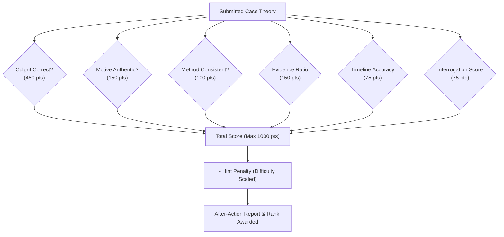

# CASEFILE 09 // DAY 5: CHRONOLOGICAL TIMELINE, DEDUCTION ENGINE & LAUNCH

---

## 📋 Day 5 Goals & Deliverables
1. **Chronological Timeline Reconstruction (`TimelineBoard.tsx`)**:
   - Multi-track timeline (Victim, Suspects, Forensic, Police).
   - Slot placement controls (Move Up / Move Down) with instant validation.
   - Automatic contradiction warnings when suspect statements conflict with forensic timestamps.
   - Real-time Chronological Integrity score (0%–100%).
2. **Deduction Engine & Theory Board (`TheoryBoard.tsx`)**:
   - Structured legal indictment builder:
     1. Primary Perpetrator selection.
     2. Documented Motive articulation.
     3. Execution Method & Opportunity reconstruction.
     4. Crucial Supporting Evidence linkage.
     5. Refuted Alibi and Contradiction linkage.
   - Live theory strength calculation bar.
3. **Formal Indictment Submission (`CaseClosureModal.tsx`)**:
   - Case closure review modal before Grand Jury submission.
4. **After-Action Report (AAR) & Results (`ResultsPage.tsx`)**:
   - Deterministic scoring algorithm out of 1000 points.
   - Outcome tiers: `Perfect`, `Partial`, `Failed`.
   - 6 investigator ranks (Trainee to Elite Investigator).
   - 8 unlockable commendation medals with celebratory confetti.
5. **Quality Assurance & Automated Verification**:
   - End-to-end automated test suite (`test-investigation-suite.ts`) verifying 50/50 assertions.
   - Production bundle generation via Vite and Git deployment.

---

## ⚖️ Deduction & Scoring Logic

---

## 🧪 Day 5 Verification Checklist
- [x] Timeline events can be re-ordered and auto-aligned to verified timestamps.
- [x] Contradiction badges trigger on conflicting suspect statements.
- [x] Deduction engine correctly validates culprit, motive, and method against authored rules.
- [x] After-Action Report renders grand jury outcome and awards investigator rank.
- [x] 50 / 50 automated tests pass in `test-investigation-suite.ts`.
- [x] Production build generated cleanly with zero errors.
