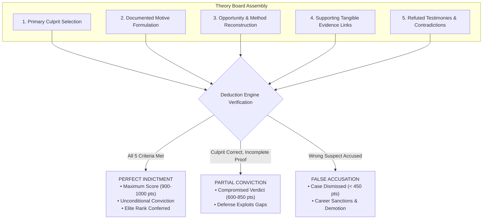

# CASEFILE 09 // DEDUCTION ENGINE OPERATOR'S MANUAL
> **Federal Investigation Bureau // Judicial Affairs Division**
> *Standard Indictment Formulation Protocol Ref: DED-IND-09*

---

## 1. Indictment Formulation Overview

The **Theory Board** (`src/components/deduction/TheoryBoard.tsx`) and **Deduction Engine** (`src/engine/deductionEngine.ts`) represent the judicial core of **CASEFILE 09**. An investigator cannot simply point a finger; they must build an ironclad prosecution case that withstands Grand Jury review.



---

## 2. The Five Pillars of a Valid Indictment

### Pillar 1: The Perpetrator
The investigator must nominate one individual from the suspect roster. The selection is cross-referenced with `CaseData.deductionRules.correctCulpritId`.
- **Weight**: 450 points ($45\%$ of maximum possible score).
- An incorrect selection immediately caps the verdict tier to `failed`.

### Pillar 2: The Motive
The investigator must articulate the suspect's underlying motive. The engine uses fuzzy semantic keyword parsing against `deductionRules.validMotiveDescriptions`:
```typescript
const motiveCorrect = rules.validMotiveDescriptions.some(desc => 
  submittedMotiveLower.includes(desc.toLowerCase()) || 
  desc.toLowerCase().includes(submittedMotiveLower) ||
  (submittedMotiveLower.length > 10 && rules.validMotiveDescriptions.some(kw => submittedMotiveLower.includes(kw.split(' ')[0].toLowerCase())))
);
```
- **Weight**: 150 points.
- Accounts for financial embezzlement, inheritance disputes, blackmail silence, or government conspiracy.

### Pillar 3: Opportunity & Method of Execution
The investigator must describe the physical sequence of events: weapon deployed, entry point, and toxicological or mechanical vehicle.
- The engine matches against `deductionRules.correctMethodKeywords`.
- **Weight**: 100 points.

### Pillar 4: Crucial Supporting Evidence
The investigator must link physical evidence items discovered during the investigation that definitively tie the culprit to the crime:
$$\text{Crucial Evidence Ratio} = \frac{\text{Selected Crucial Evidence Items}}{\text{Total Required Crucial Evidence Items}}$$
- **Weight**: Up to 105 points.

### Pillar 5: Refuted Alibis & Contradictions
The investigator must link evidence items that shatter false suspect alibis:
$$\text{Contradiction Ratio} = \frac{\text{Selected Refuted Evidence Items}}{\text{Total Refuted Evidence Items}}$$
- **Weight**: Up to 45 points.

---

## 3. Case Theory Strength Calculation

While drafting an indictment in `TheoryBoard.tsx`, a real-time strength meter updates to give the investigator feedback before formal submission:

```typescript
const isComplete = 
  draft.proposedCulpritId && 
  draft.motive.trim().length > 5 && 
  draft.opportunityMethod.trim().length > 5 && 
  draft.supportingEvidenceIds.length >= 2;

const strengthScore = 
  (draft.proposedCulpritId ? 30 : 0) +
  (draft.motive.length > 10 ? 20 : 0) +
  (draft.opportunityMethod.length > 10 ? 20 : 0) +
  Math.min(30, draft.supportingEvidenceIds.length * 10);
```

- **0%–49% (Incomplete / Speculative)**: Indictment submission disabled.
- **50%–79% (Circumstantial)**: High risk of defense rebuttal.
- **80%–100% (Ironclad)**: Ready for Grand Jury submission.

---

## 4. Grand Jury Narrative Outcomes

Every case features three meticulously authored narrative epilogues based on the verdict tier:

| Tier | Required Conditions | Narrative Epilogue Impact |
| :--- | :--- | :--- |
| **Perfect** | Culprit correct, motive validated, method proven, evidence score $\ge 60$ | Full confession obtained, accomplice networks unmasked, federal commendation. |
| **Partial** | Culprit correct, but lacking crucial evidence or flawed motive | Culprit indicted on secondary charges or receives reduced sentencing; defense exploits loopholes. |
| **Failed** | Wrong suspect accused | Innocent citizen detained, real killer flees jurisdiction, investigator stripped of credentials. |

---

## 5. Tactical Advice for High-Scoring Indictments
1. **Never guess the culprit early**: Interrogate all suspects to dynamic stress $>70\%$ first to force confessions and uncover motive details.
2. **Review all forensic lab reports**: Match toxicological chemical names (e.g., *Digoxin*) and ballistic calibers directly in your written method description.
3. **Link both supporting and contradicting evidence**: A strong prosecution proves not only what happened, but also proves that the suspect's claimed alibi was physically impossible.
