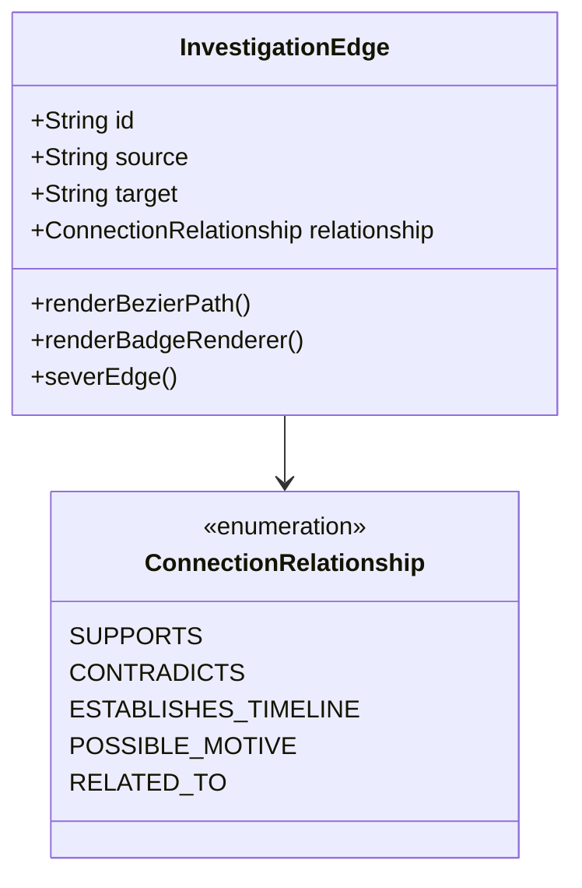

# EVIDENCE BOARD ARCHITECTURAL SPECIFICATION
> **CASEFILE 09 // Physical Investigation Board Engine**

---

## 1. Overview & System Design
The Evidence Board simulates a physical detective corkboard / magnetic white-room evidence wall. Built with `@xyflow/react`, it provides a smooth, tactile, 60fps canvas for arranging clues, pinning photographic exhibits, making handwritten annotations, and connecting red yarn strings across exhibits.

---

## 2. Node Typology & Data Contracts

### A. PhotoNode (`src/components/investigation/nodes/PhotoNode.tsx`)
- **Visuals**: Classic Polaroid frame with distressed edges, exhibit stamp (`EXHIBIT A`), discovery timestamp, and grayscale-to-color hover transition.
- **Actions**: Direct trigger to open exhibit in the Photographic Lens lab.
- **Handles**: 4 cardinal connection points (Top, Bottom, Left, Right) styled as red pushpins.

### B. DocumentNode (`src/components/investigation/nodes/DocumentNode.tsx`)
- **Visuals**: Manila cardstock aesthetic (`#15181f`), stamped classification badge (`CONFIDENTIAL`), typewriter font preview excerpt.
- **Actions**: Trigger to open document in the Optical Decryptor lab.

### C. ForensicNode (`src/components/investigation/nodes/ForensicNode.tsx`)
- **Visuals**: Emerald forensic laboratory slide styling with verified audit seal, specimen sequence ID, and laboratory summary.
- **Actions**: Trigger to open quantitative forensic instruments (DNA gel, Ballistics, HPLC).

### D. NoteNode (`src/components/investigation/nodes/NoteNode.tsx`)
- **Visuals**: Aged yellow sticky note with realistic 3D red pushpin graphic at the top center.
- **Actions**: Inline editable textarea with real-time sync to session store.

### E. VictimNode (`src/components/investigation/nodes/VictimNode.tsx`)
- **Visuals**: Prominent crime scene epicenter card with deceased stamp, cause of death, and estimated post-mortem window.
- **Placement**: Automatically positioned at center top (`x: 380, y: 40`) upon case initialization.

---

## 3. Yarn Connection Physics & Semantics

Connections between nodes represent logical deductions made by the investigator. Each connection is modeled as an `InvestigationEdge`:



### Relationship Types & Color Coding:
1. `supports`: Corroborates physical evidence or verifies witness testimony (Emerald `#10b981`).
2. `contradicts`: Refutes an alibi or exposes a physical impossibility (Crimson `#ef4444`).
3. `establishes_timeline`: Fixes the chronological order of occurrences (Amber `#f59e0b`).
4. `possible_motive`: Indicates financial, personal, or syndicate drive (Purple `#a855f7`).
5. `related_to`: Circumstantial or indirect link (Charcoal `#9ca3af`).

---

## 4. State Synchronization & Persistence

All board mutations are dispatched through Zustand to ensure reactive updates and automatic persistence:

```typescript
// Updating Node Positions
onNodesChange: (changes: NodeChange[]) => {
  const updatedNodes = applyNodeChanges(changes, rawNodes);
  updateBoardNodes(caseId, updatedNodes);
}

// Creating Red Yarn Connection Strings
onConnect: (params: Connection) => {
  setPendingConnection(params); // Prompts user to select relationship
}

// Finalizing Connection String
confirmConnection: (rel: ConnectionRelationship) => {
  const newEdge = { id: `edge-...`, source, target, type: 'investigation', data: { relationship: rel } };
  updateBoardEdges(caseId, [...rawEdges, newEdge]);
  audioEngine.playStringPluck(); // Tactical audio feedback
}
```
