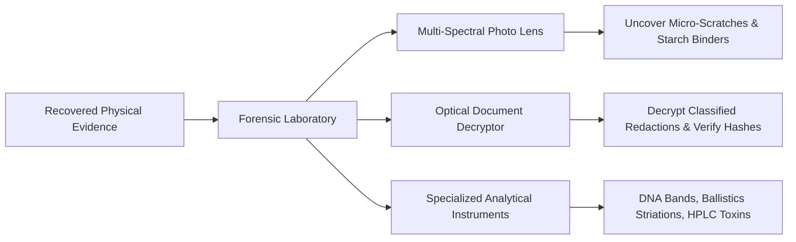

# CASEFILE 09 // FORENSIC LABORATORY OPERATOR'S MANUAL
> **Bureau Criminalistics Division // Standard Operating Procedure**
> *Classified Technical Manual Ref: CRIM-LAB-09*

---

## 1. Overview of Forensic Facilities

The **CASEFILE 09** Criminalistics Laboratory provides investigators with laboratory-grade examination instruments for scrutinizing physical evidence, documents, and biological specimens recovered from crime scenes.



---

## 2. Multi-Spectral Photographic Examination

### Optical Controls
- **Zoom Range**: `70%` to `250%` in `20%` steps, managed via hardware-accelerated CSS scaling.
- **Rotation**: `90°` clockwise increments with smooth transform transitions.

### Spectral Filter Matrix
| Filter Mode | Spectral Band | Visual Transformation | Diagnostic Use Case |
| :--- | :--- | :--- | :--- |
| **Standard** | Visible Light ($400\text{--}700\text{ nm}$) | Natural true-color rendering | Baseline macro observation and scene context. |
| **UV Fluorescence** | Ultraviolet ($365\text{ nm}$) | `contrast(160%) brightness(85%) hue-rotate(240deg) saturate(220%)` | Unmasks latent biological traces, synthetic drug starches, and security inks. |
| **Infrared Scan** | Near-Infrared ($850\text{--}1050\text{ nm}$) | `invert(90%) hue-rotate(180deg) contrast(150%)` | Reveals thermal residue, charred document text, and gunpowder discharge patterns. |
| **Optical Magnifier** | High-Pass Optical Filter | `contrast(135%) brightness(110%)` | Accentuates micro-fractures, signet ring impressions, and serial number tampering. |

### Hotspot Coordinate Discovery System
Each photographic exhibit contains hidden forensic coordinates defined as normalized percentages:
```typescript
interface Hotspot {
  id: string;
  x: number; // 0 - 100 percentage from left
  y: number; // 0 - 100 percentage from top
  label: string;
  description: string;
}
```
When an investigator hovers and clicks on an active hotspot:
1. The pulsing crimson beacon turns to a solid emerald checkmark.
2. A detailed laboratory diagnostic banner appears at the base of the viewport.
3. The global state store invokes `revealHiddenLayer(caseId, evidenceId)`, permanently unlocking the clue for the Deduction Theory Board.
4. Procedural audio cue `playContradictionStinger()` plays if sound effects are enabled.

---

## 3. Optical Document Decryptor

### Physical Representation
- Scanned aged parchment background (`#f3ece0`) with authentic typewriter font styling (`Courier Prime`).
- Official Division 09 header classification watermark and stamped `TOP SECRET` badge.

### Redaction Decryption Algorithm
Lines flagged with blacked-out redacted blocks (`████████████████████`) are interactive:
- Clicking a redacted block removes the censor overlay and highlights the line with an amber accent (`bg-amber-100/70 border-l-2 border-evidence-red`).
- Automatically triggers `revealHiddenLayer(caseId, evidence.id)`.
- Plays an authentic mechanical typewriter strike audio cue (`playTypewriterKey()`).

### Metadata & Chain of Custody Audit
The document inspector includes a cryptographic ledger:
- **Algorithm**: `SHA-256` tamper-evident document hashing.
- **Chain of Custody**: Logs recovering agent callsign, recovery location, and timestamp.
- **Classified Clearance**: Enforces security tier checking before releasing full unredacted files.

---

## 4. Specialized Analytical Instruments

### A. Agarose Gel Electrophoresis (DNA)
Used in cases involving biological fluids, blood splatters, and tissue fragments (e.g., CASE 001, CASE 002):
- **Cathode ($-$) to Anode ($+$) Chamber**: Simulates electric migration of negatively charged DNA fragments through a 1.8% agarose gel matrix.
- **Lanes**:
  1. *Marker/Ladder*: Standard molecular weight sizing benchmarks.
  2. *Victim Lane*: Verified reference profile of the victim.
  3. *Crime Scene Specimen Lane*: Glowing cyan bands recovered from the scene.
  4. *Suspect Reference Lane*: Profile of the accused subject.
- **Validation**: Matching band positions render glowing cyan and crimson indicators with statistical confidence ratio of **1 in 4.8 Billion**.

### B. Ballistics Split-Screen Comparator
Used in firearm homicides and weapon seizures (e.g., CASE 003, CASE 004):
- **Split Comparator Slider**: An interactive divider slider ($0\%\text{--}100\%$) allows investigators to sweep between the test-fired reference projectile and the recovered scene bullet.
- **Microscopic Alignment**: Compares helical land and groove impressions, firing pin indentations, and extractor scratch marks.

### C. High-Performance Liquid Chromatography (HPLC Toxicology)
Used in poisoning and chemical homicide investigations (e.g., CASE 001, CASE 009):
- **Chromatogram Spectrum**: Visualizes absorbance vs. retention time ($R_t$).
- **Peak Identification**: Distinct peaks identify compound retention times (e.g., Cyanide, Synthetic Fentanyl, Strychnine).
- **Threshold Curves**: Compares detected concentration against lethal human toxicity thresholds.

---

## 5. Summary Checklist for Forensic Investigators
- [x] Rotate and inspect photos at $150\%\text{--}200\%$ magnification to locate hidden hotspots.
- [x] Toggle UV and Infrared modes on all physical evidence to reveal invisible residue.
- [x] Click every blacked-out redaction bar in official documents to decode classified passages.
- [x] Run DNA electrophoresis and ballistics comparisons before finalizing arrest theories.
