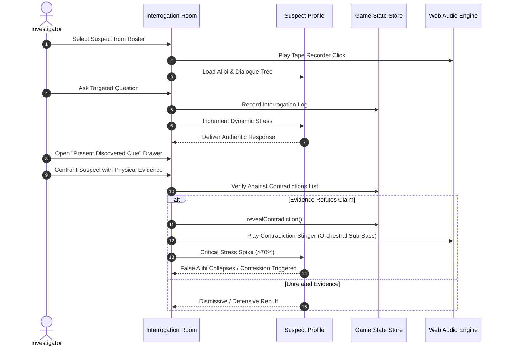

# CASEFILE 09 // INTERROGATION CHAMBER TACTICAL MANUAL
> **Federal Criminal Investigation Simulator // Interrogation Division**
> *Classified Operational Manual Ref: INTR-TAC-09*

---

## 1. Overview of the Interrogation Chamber

The **Interrogation Chamber** (`InterrogationRoom.tsx`) is where investigative logic meets human psychology. Investigators confront persons of interest, evaluate body language and alibis, ask targeted questions, and expose contradictions by presenting physical evidence.



---

## 2. Suspect Dossier & Roster Structure

Each case in **CASEFILE 09** features at least three fully developed suspects with distinct psychological profiles:

| Suspect Attribute | Description | Impact on Interrogation |
| :--- | :--- | :--- |
| `name` & `callsignOrAlias` | Full legal identity and underworld alias | Establishes dossier identity. |
| `portraitUrl` | High-contrast black & white photographic portrait | Displays mood lighting and tension vignette. |
| `age` & `occupation` | Professional background and age | Influences vocabulary and defensive posture. |
| `claimedAlibi` | Official statement given during initial questioning | The narrative target investigators must scrutinize. |
| `knownMotive` | Financial, revenge, or political reason to commit crime | Clues investigators should probe in the dialogue tree. |
| `stressLevel` | Initial baseline psychological composure (0–100%) | Determines how resilient the suspect is to questioning. |
| `dialogueTree` | Array of deterministic questions, answers, and stress deltas | Structured interview branching. |
| `contradictions` | Specific falsehoods refuted by tangible evidence IDs | Triggers alibi breakdown when presented with matching proof. |

---

## 3. Dynamic Psychological Stress Calculation

A suspect's psychological stress is governed by their baseline stability, the cumulative inquiries logged, and whether they have been confronted with incriminating physical evidence:

$$\text{Dynamic Stress} = \min\left(100, \max\left(10, S_0 + (N_Q \times 6) + (N_E \times 15)\right)\right)$$

Where:
- $S_0$ = Suspect's initial baseline stress level.
- $N_Q$ = Total number of inquiries conducted with this suspect.
- $N_E$ = Number of physical evidence items presented to this suspect.

### Composure States:
- **Composed (10%–40% / Emerald Green)**:
  - *Behavioral Profile*: Calm, smug, dismissive, cooperative or strictly evasive.
  - *Response Style*: Polite denials and firm reliance on their alibi.
- **Agitated (41%–70% / Terminal Amber)**:
  - *Behavioral Profile*: Fidgeting, hostile deflections, stammering, defensive counter-questions.
  - *Response Style*: Minor inconsistencies begin slipping into their statements.
- **Critical Breakdown (71%–100% / Evidence Red - Pulsing)**:
  - *Behavioral Profile*: Severe psychological agitation, visible panic, eye contact severed.
  - *Response Style*: Vulnerable to full confession, alibi collapses completely.

---

## 4. Dialogue Mechanics & Deterministic Branching

### Dialogue Option Schema
```typescript
interface DialogueOption {
  id: string;
  prompt: string;         // The exact question the investigator speaks
  response: string;       // The suspect's deterministic reply
  stressDelta: number;    // Immediate change in suspect's composure
  unlockedByEvidenceId?: string; // Clue needed before this question appears
  leadsToDialogueId?: string;    // Follow-up branching node
}
```

### Deterministic Reliability
Rather than relying on unpredictable LLM generation during gameplay, **CASEFILE 09** uses hand-crafted deterministic dialogue trees:
- Every line has narrative significance and fits the neo-noir atmosphere.
- Every contradiction has a rock-solid logical foundation based on the case evidence.
- Full interrogation transcripts are recorded permanently in the case session store for later review on the Deduction Board.

---

## 5. Presenting Evidence & Exposing Contradictions

### The Confrontation Flow:
1. Investigator clicks **"PRESENT DISCOVERED CLUE"** in the chamber action bar.
2. An evidence selection drawer slides open, displaying all physical items, documents, and forensic reports currently discovered in the case.
3. Investigator clicks on the evidence item they believe shatters the suspect's testimony.
4. The system validates the item against `suspect.contradictions`:

```typescript
const matchingContradiction = suspect.contradictions.find(
  c => c.refutedByEvidenceId === evidenceId
);

if (matchingContradiction) {
  revealContradiction(caseId, matchingContradiction.id);
  audioEngine.playContradictionStinger();
}
```

### Contradiction Exposure Effects:
- **Acoustic Cue**: A heavy sub-bass drone and dissonant string stinger plays (`playContradictionStinger()`).
- **Transcript Highlight**: A permanent contradiction alert banner is appended to the interrogation transcript.
- **Theory Board Link**: The refuted claim is flagged on the Deduction Board, providing the required factual basis for issuing an arrest warrant.
- **Stress Surge**: Spikes the suspect's stress meter by $+15\%$ to $+30\%$.

---

## 6. Pro-Tips for Investigators
1. **Examine Evidence First**: Always inspect documents in the Optical Decryptor and photos in the Photo Lab before stepping into the interrogation room to unlock advanced questions.
2. **Observe the Stress Meter**: If a suspect's stress remains under $40\%$, asking routine questions will not yield confessions. You must present concrete forensic evidence.
3. **Save Contradictions for the Climax**: Shattering an alibi with physical proof when the suspect is already agitated ($>60\%$ stress) will often trigger an immediate admission of guilt.
