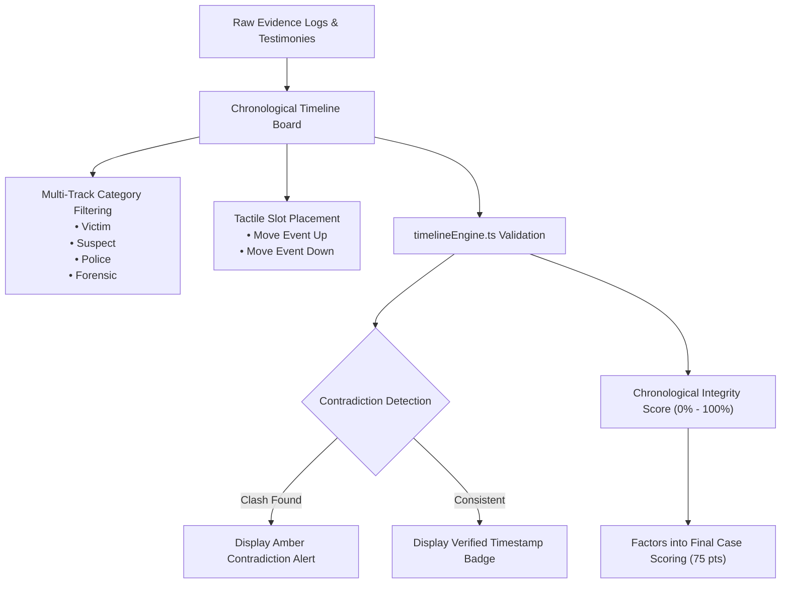

# CASEFILE 09 // TIMELINE RECONSTRUCTION OPERATOR'S MANUAL
> **Federal Criminal Investigation Simulator // Chronology & Forensic Records**
> *Standard Timeline Reconstruction Protocol Ref: TIME-REC-09*

---

## 1. Chronological Timeline Reconstruction Overview

The **Timeline Reconstruction Board** (`src/components/timeline/TimelineBoard.tsx`) allows investigators to untangle the web of conflicting statements, phone records, surveillance logs, and forensic timestamps into a definitive sequence of events.



---

## 2. Event Structure & Data Model

Every event placed along the timeline follows a structured schema:

```typescript
interface TimelineEvent {
  id: string;
  timeString: string;          // Formatted time, e.g. "10:45 PM"
  timestampMinutes: number;    // Absolute minutes from midnight, e.g. 1365
  category: 'victim' | 'suspect' | 'police' | 'forensic';
  title: string;
  description: string;
  isContradiction?: boolean;   // True if this event exposes a lie
  contradictionNote?: string;  // Detailed explanation of the clash
  relatedSuspectId?: string;
  relatedEvidenceId?: string;
}
```

### Event Categories:
- 🔵 **Victim Track**: Last known sightings, text messages, and movements leading up to the crime.
- 🔴 **Suspect Track**: Statements claimed by suspects during interviews.
- 🟢 **Forensic Track**: Objective autopsy estimated time of death (TOD), lab results, and ballistics.
- ⚪ **Police Track**: Emergency 911 dispatch calls, first responder arrival, and perimeter security.

---

## 3. Timeline Scoring & Validation Engine

The mathematical logic in `src/engine/timelineEngine.ts` evaluates both the pairwise ordering of events and the completeness of the timeline:

### Pairwise Sorting Ratio
For each adjacent pair of events $(E_i, E_{i+1})$ in the user's ordered sequence:
$$\text{Pair Correct} = \begin{cases} 1 & \text{if } t(E_i) \le t(E_{i+1}) \\ 0 & \text{otherwise} \end{cases}$$

$$\text{Order Ratio} = \frac{\sum \text{Correct Pairs}}{\text{Total Adjacent Pairs}}$$

### Placement Ratio
$$\text{Placement Ratio} = \frac{\text{Placed Events Count}}{\text{Total Case Events Count}}$$

### Overall Chronological Integrity Score:
$$\text{Integrity Score} = \min\left(100, \max\left(20, \text{round}\left((\text{Order Ratio} \times 0.7 + \text{Placement Ratio} \times 0.3) \times 100\right)\right)\right)$$

- **Integrity $\ge 90\%$**: Full $75$ points awarded in Grand Jury scoring.
- **Order Ratio $< 50\%$**: Heavy penalization, indicating an incoherent chronological theory.

---

## 4. Contradiction Detection Mechanic

When a suspect claims to have been in one location while forensic evidence or surveillance places them elsewhere at that exact timestamp:
1. The timeline event is automatically flagged with an amber exclamation badge (`AlertTriangle`).
2. The card reveals a **Contradiction Alert**:
   > *"CONTRADICTION DETECTED: Suspect claims to have been at the downtown diner, but phone tower pings place their device 300 meters from the crime scene at 11:15 PM."*
3. This timestamp contradiction can then be linked directly on the **Theory Board** to invalidate the suspect's alibi.

---

## 5. UI Controls & Accessibility
- **Move Up / Down**: Tactile single-step controls to reposition events without complex drag-and-drop glitches.
- **Filter Tabs**: Quickly isolate events by category (`All`, `Victim`, `Suspect`, `Forensic`, `Police`).
- **Auto-Align to Verified Timestamps**: In lower difficulties (Rookie), investigators can press the reset button to snap all events into verified chronological order.
